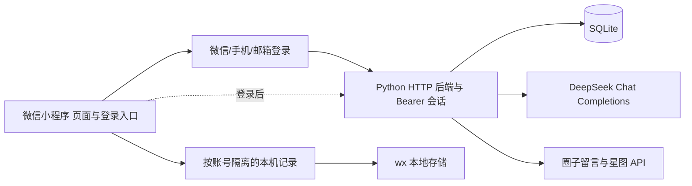

# 云间小窝：项目交接与简历素材

记录时间：2026-10-27  
项目类型：原生微信小程序 MVP，主题为宠物离世后的纪念与陪伴。

## 当前进度

- 据项目创建者反馈，体验版已经发布给体验用户。
- `project.config.json` 中的小程序 AppID 已配置为当前提供的 AppID；它不是 AppSecret。
- 小程序业务资料仍使用本机存储：`miniprogram/app.js` 的 `apiBaseUrl` 默认空字符串。当前版本已加入微信、手机号和邮箱登录页面及后端会话接口；真实登录需部署后端并配置 API 地址及验证码服务。微信开发者工具另有仅本机有效的演示入口，可预览业务页面，不代表真实登录已连通。
- 仓库包含 FastAPI 后端、DeepSeek 代理代码和 SQLite 表结构，但本次检查没有发现它已部署成线上服务，也没有发现小程序已切到该服务。
- 因此，体验版发布不等于正式版已发布。登录代码已接入，但尚需部署线上服务、配置微信/短信/邮件凭据、使用 HTTPS 合法域名，并完成隐私与内容治理、平台审核及正式版提交。
- README 中原先的 `touristappid` 占位说明与当前配置不一致，现已更新。
- 当前项目文件还没有 Git 提交记录；简历展示前建议先整理仓库、核对敏感文件，再提交到私有或公开代码托管平台。

## 产品功能框架

产品名为“云间小窝”，设计方向是安静、温柔、低干预的宠物纪念空间。当前页面包含：

| 页面 | 主要用途 |
| --- | --- |
| 启动页、登录页、首页 | 进入产品、注册/登录和功能导航 |
| 云窝档案 | 保存宠物基本信息、性格与回忆 |
| 悄悄话信箱 | 记录用户写给宠物的话 |
| 云间来信 | 每日生成或展示一封纪念来信 |
| 同念星云 | 以匿名聚合地区星点和短句留下纪念 |
| 云伴小栈 | 按离世时间分组的匿名纯文字交流 |
| 云窗 | 小程序内的轻量展示样式预览 |
| 我的、设置与隐私 | 用户入口、功能开关及隐私相关设置 |

目前社区没有私聊、点赞、@或多层回复；同念星云不读取 GPS，只有用户主动选择省级地区、国家或大洋并同意后才记录位置代码，地图只返回匿名聚合人数。界面里的“云窗”是小程序页面预览，不代表已经注册了 iOS/Android 系统桌面小组件。

当前没有商品、购物车或微信支付，因此它还没有电商 checkout 流程。

## 技术架构



### 小程序端

- 原生微信小程序：WXML、WXSS、JavaScript，无额外前端框架。
- `miniprogram/utils/data.js` 封装本机数据读写和默认数据。
- `miniprogram/utils/api.js` 封装通用 HTTP 请求。
- `miniprogram/utils/ai.js` 组装宠物档案上下文、调用 AI 接口、提供本地示例回复，并对部分高风险 AI 表述做兜底替换。
- `miniprogram/utils/safety.js` 包含基础敏感词与极端情绪关键词判断。

### 后端

- `backend/server.py` 使用 FastAPI/Uvicorn 提供 HTTP 服务，业务数据存储在 SQLite；外部 API 请求使用 `urllib`。
- API：`GET /health`、`GET/POST /api/stars`、`GET/POST /api/circles/{circle}/posts`、`POST /api/chat`、`POST /api/daily-letter`。
- DeepSeek API Key 由 `DEEPSEEK_API_KEY` 环境变量提供；系统提示词留在服务端；模型请求正文不会被当前代码写入数据库或普通访问日志。
- 当前服务默认监听 `127.0.0.1:8787`。这适合本机开发，不是线上配置；云托管需要按平台要求改为监听 `0.0.0.0` 与平台注入的端口。
- 后端实现了微信 `code2Session` 登录、邮件/短信验证码、会话过期与撤销、验证码发送限流，以及 API Bearer 身份校验；宠物记忆按用户隔离。仍未实现跨设备个人数据同步、账户删除流程、管理员审核台和生产级运维监控。微信、邮件及短信服务需自行配置凭据。

### 数据

- 小程序端当前数据键定义在 `miniprogram/utils/data.js`：宠物档案、设置、对话、来信、星图、帖子和加入的圈子。
- `backend/schema.sql` 设计了账号、档案、聊天、来信、设置、订阅、圈子、星图和自愿加入的位置表。服务端目前接入账号/会话、宠物记忆、星图、匿名星云位置聚合和圈子留言；档案、聊天历史、来信和设置仍不在云端 API 中。
- `backend/cloud_nest.sqlite3` 是本地运行时数据库文件，已由 `.gitignore` 排除，不是代码源码。
- 已有登录账号体系，但档案、照片、对话和来信仍按账号保存在当前设备，不会同步到云端。尚无真实用户行为分析。生产数据分析应先定义同意与最小化采集范围，并避免把原始私密聊天、宠物故事当作普通埋点内容记录。

## 文件清单

```text
README.md
PROJECT_OVERVIEW.md
.env.example
.gitignore
.DS_Store                         # macOS 文件浏览器元数据
project.config.json
project.private.config.json
backend/
  server.py
  schema.sql
  cloud_nest.sqlite3              # 本地运行时文件，已忽略
miniprogram/
  app.js
  app.json
  app.wxss
  sitemap.json
  assets/
    cloud-nest-avatar.png
    cloud-nest-avatar.svg
  utils/
    ai.js
    api.js
    data.js
    safety.js
  pages/
    auth/{auth.js,auth.json,auth.wxml,auth.wxss,policy.js,policy.json,policy.wxml,policy.wxss}
    launch/{launch.js,launch.json,launch.wxml,launch.wxss}
    home/{home.js,home.json,home.wxml,home.wxss}
    profile/{profile.js,profile.json,profile.wxml,profile.wxss}
    mailbox/{mailbox.js,mailbox.json,mailbox.wxml,mailbox.wxss}
    letters/{letters.js,letters.json,letters.wxml,letters.wxss}
    starmap/{starmap.js,starmap.json,starmap.wxml,starmap.wxss}
    community/{community.js,community.json,community.wxml,community.wxss}
    widget/{widget.js,widget.json,widget.wxml,widget.wxss}
    me/{me.js,me.json,me.wxml,me.wxss}
    settings/{settings.js,settings.json,settings.wxml,settings.wxss}
```

每个页面由 `.js` 页面逻辑、`.json` 页面配置、`.wxml` 结构和 `.wxss` 样式组成。

## 已完成的开发流程

1. 从零搭建原生小程序项目和页面骨架。
2. 实现 10 个页面与导航，建立宠物档案、信箱、来信、星图、小栈和设置等 MVP 功能。
3. 将体验版数据保存在微信本地存储，未配置线上接口时提供明确的本地 AI 示例回复。
4. 编写 Python 后端原型、DeepSeek 服务端代理、基础文本过滤、输出保护，以及 SQLite schema。
5. 在微信开发者工具中预览并上传代码；此前检查记录为代码包约 239 KB、模拟器 0 错误和 7 条警告。
6. 体验版发布状态以创建者后续确认的信息为准。尚无正式版审核通过或正式发布的记录。

## 简历可用表述

> 独立完成原生微信小程序“云间小窝”MVP，搭建 10 个业务页面及本机数据持久化；设计 FastAPI 后端与 SQLite 数据结构，开发 DeepSeek 服务端代理和基础内容安全处理，并交付微信体验版。

面试时可以补充：登录代码已实现，但线上后端与短信/邮件凭据尚未配置；用户数据云同步、账户删除、生产级内容治理、行为分析和正式版审核仍属于后续迭代。不要把原型代码描述成已经承载真实用户的生产系统，也不要虚构用户量、留存率或营收指标。

## 后续上线顺序建议

1. 先撤销此前在对话中发送过的 DeepSeek API Key 并新建密钥；新密钥只配置在云端环境变量中，不放进小程序代码、截图或 Git。
2. 在微信公众平台核验主体、服务类目、备案和当前体验版/正式版状态。
3. 部署 HTTPS 后端，配置小程序合法域名、微信 AppSecret、短信/邮件服务和云端数据库；完成账户删除、数据同步、限流、成本上限与备份流程。
4. 上线 DeepSeek 之前，补齐 AI 服务说明、用户隐私告知、生成内容识别与风险处置。产品采用宠物人格进行持续情感陪伴；按 2026 年 7 月 15 日生效的官方规则定义，可能涉及“拟人化互动服务”，应先核实适用要求，并设计 AI 身份提示、退出方式、聊天记录复制/删除、未成年人保护和极端情绪处置。
5. 若开放更多用户互动，优先扩展现有匿名异步小栈：分页、举报/屏蔽、审核队列、内容处置和限流；暂不直接开放陌生人私聊。
6. 先邀请小范围体验用户，观察匿名化聚合指标，再根据问题迭代；完成平台审核后再正式发布。

以上是工程交接记录，不构成法律结论。生成式 AI 面向境内公众提供服务的适用要求与备案/登记路径，应按产品实际功能、服务提供者角色及官方最新要求进一步核验。
